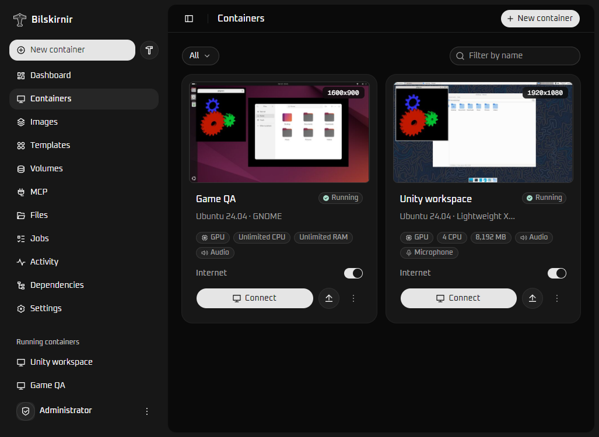

# Bilskirnir



Bilskirnir gives AI agents real Linux desktops. It runs Ubuntu desktops in Docker on WSL2 with GPU acceleration, and its MCP server is built in: an agent connects with a URL and a token, then installs software, runs commands, reads and writes files, sees the screen, clicks and types, records what happened and hands the results back to you. There is no separate MCP container to set up.

The same desktops open in your browser, so you can work in them yourself, save a prepared one as an image and start new containers from it.

The name is a nod to Thor.

## What you can do

- **Built-in MCP agent integration** with 61 tools: commands, files, mouse and keyboard, screenshots, windows, applications, recordings, audio, terminals, accessibility trees and a virtual gamepad.
- **GPU acceleration** for Linux graphics applications.
- **Separate containers with custom settings**: resolution, CPU, memory, internet, sound and microphone.
- **Access, control, change and delete** containers from the browser.
- **Snapshots and images**: save a container once and start new ones from it, or build an image from a script.
- **Composes** that ask for values such as an account when a container is created, and run a setup script with them.
- **Volumes** that keep your files after a container is deleted.
- **Drag and drop uploads** into a container.

Both supplied desktops use Ubuntu 24.04:

| Desktop | When to choose it |
| --- | --- |
| Lightweight XFCE | A smaller desktop for everyday tools and applications. |
| GNOME | Ubuntu's GNOME Shell session and Yaru theme, with higher resource use. |

Bilskirnir serves one administrator on a local machine or LAN.

## Getting started

You need Windows 11 or Windows 10 with WSL 2.4.4 or newer. GPU containers also need a Windows GPU driver with WSL support.

1. Download `bilskirnir.wsl` from the [latest release](https://github.com/co3moz/bilskirnir/releases/latest) and install it:

   ```powershell
   wsl --install --from-file .\bilskirnir.wsl
   ```

2. Open **Bilskirnir** from the Start menu. The first start asks for one username and password, used for both the Linux user and the dashboard; leave the password empty to open the dashboard without signing in. It asks whether to enable agent access and how agents authenticate (a random token by default, your own token or none), then detects the GPU and offers to start Bilskirnir.
3. Connect your agent. The first start ends with the agent endpoint, its token if it has one and settings to paste into Claude Code, another Streamable HTTP client or the stdio bridge; `bilskirnir mcp` shows them again.
4. Open [localhost:8080](http://localhost:8080), sign in with your username and password and select **New container**. The first container from XFCE or GNOME downloads that image, and the job panel shows the progress. Select **Connect** once it is running.

WSL stops a distribution shortly after its last window closes; [Keep it running](docs/WSL_PACKAGE.md#keep-it-running) explains how to keep Bilskirnir available. The [WSL package guide](docs/WSL_PACKAGE.md) covers the `bilskirnir` command, updates and removal.

## Custom installation

The WSL package is the recommended installation. Bilskirnir itself needs only an x86_64 Linux host with Docker Engine and Compose v2, so you can also run it with Compose on a host you manage yourself, such as your own WSL2 distribution or another Linux machine.

Run the commands below on that host, as a user who can use Docker.

GPU acceleration currently goes through WSL's GPU support: it needs a host where `/dev/dxg` and `/usr/lib/wsl` exist, and CUDA also needs NVIDIA Container Toolkit configured for Docker Engine. The example enables both for an NVIDIA GPU. For AMD/Intel, set `NVIDIA_COMPUTE` to `"false"` and change `GPU_ADAPTER`. On a host without WSL GPU support, or to run without a GPU, set both `WSL_GPU` and `NVIDIA_COMPUTE` to `"false"`; containers then use software rendering and the GPU option is unavailable when creating one.

Save this as `compose.yml` and change `ADMIN_PASSWORD` to a password of at least eight characters. Everything else can stay as shown for an NVIDIA GPU under WSL:

```yaml
name: bilskirnir

services:
  manager:
    image: ghcr.io/co3moz/bilskirnir:latest
    container_name: bilskirnir-manager
    restart: unless-stopped
    ports:
      - "127.0.0.1:8080:8080" # Use 0.0.0.0 instead for LAN access.
    labels:
      io.wsl-desktop.manager: "true"
    environment:
      MANAGER_CONTAINER: bilskirnir-manager
      AUTH_MODE: password # Use none to disable login.
      ADMIN_USERNAME: admin
      ADMIN_PASSWORD: "replace-with-your-password"
      DESKTOP_IMAGE: ghcr.io/co3moz/bilskirnir/ubuntu-xfce:24.04
      # GPU access for containers created in the UI. Without WSL GPU support, set both to "false".
      WSL_GPU: "true"
      NVIDIA_COMPUTE: "true" # Set false for AMD/Intel or without CUDA support.
      GPU_ADAPTER: NVIDIA # Use AMD / Intel for other adapters.
      AUDIO_ENABLED: "true"
      MICROPHONE_ENABLED: "true"
      UPLOAD_MAX_MB: "1024"
      ALLOWED_HOSTS: localhost
    volumes:
      - /var/run/docker.sock:/var/run/docker.sock
      - manager-data:/data

volumes:
  manager-data:
    name: bilskirnir-data
```

Start Bilskirnir:

```bash
docker compose up -d
```

The first start downloads only the manager. You do not need to clone this repository or build anything locally. Open [localhost:8080](http://localhost:8080) and sign in as `admin` using your chosen password.

Agent access is off in this setup. [Enable agent access](docs/MCP.md#enable-agent-access) shows the two settings that turn it on. [Installation and maintenance](docs/INSTALLATION.md) covers the remaining settings, LAN access and updates.

## Where to go next

- [Agent access with MCP](docs/MCP.md): connecting a client, the tool list and agent workflows.
- [Using Bilskirnir](docs/USAGE.md): containers, GPU applications, images, snapshots, volumes, uploads and settings changes.
- [WSL distribution package](docs/WSL_PACKAGE.md): installing, keeping it running, everyday commands, memory and disk size, and removal.
- [Installation and maintenance](docs/INSTALLATION.md): settings, LAN access, HTTPS, updates and recovery.
- [HTTP API](docs/API.md): the same operations for scripts and other applications.
- [Development](docs/DEVELOPMENT.md): source builds, project structure, checks, image publishing and the WSL package build.
- [Interface design](docs/DESIGN.md): visual choices and guidance for interface changes.
- [Verification notes](docs/BUG_HUNT.md): the October 2026 bug audits, what they checked and what they did not prove.

Bilskirnir is written in Rust with a plain JavaScript frontend and is released under the [MIT license](LICENSE). Its bundled components keep their [own licenses](THIRD_PARTY_NOTICES.md).
