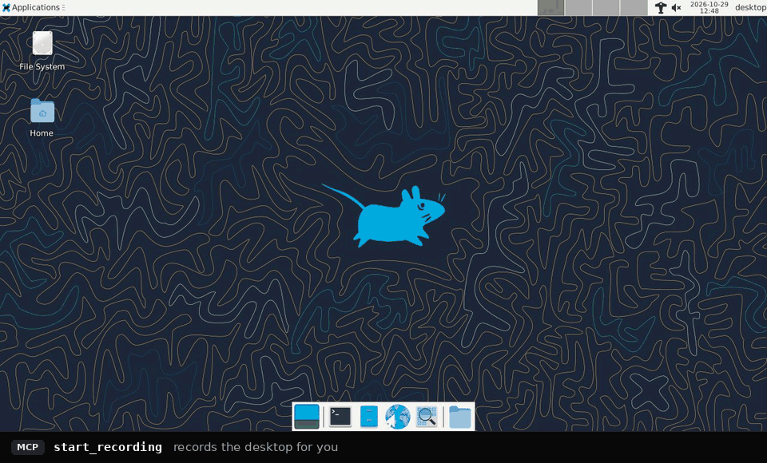
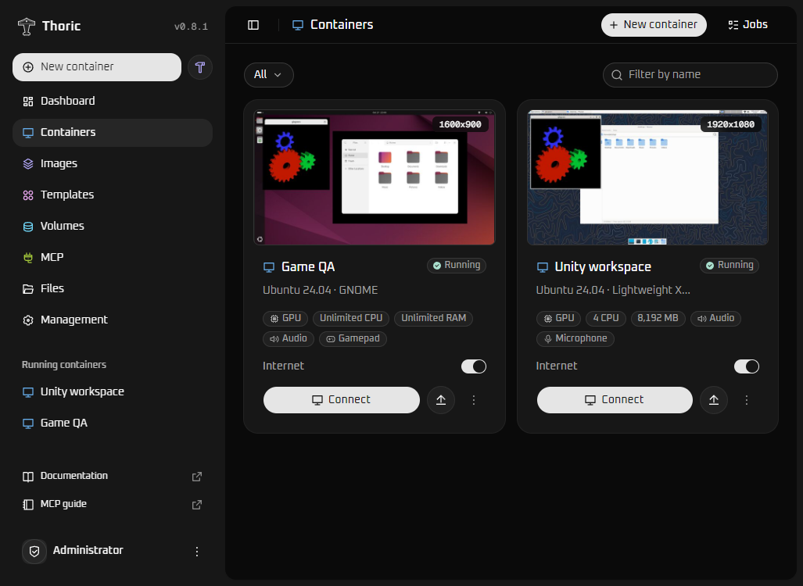

# Thoric



*An agent at work in a real installation, recorded with `start_recording`. The bar under the desktop names each MCP tool call.*

Thoric gives AI agents real Linux desktops. It runs Ubuntu desktops in Docker, on WSL2 or on a Linux host, with GPU acceleration, and its MCP server is built in: an agent connects with a URL and a token, then installs software, runs commands, reads and writes files, sees the screen, clicks and types, records what happened and hands the results back to you. There is no separate MCP container to set up.

The same desktops open in your browser, so you can work in them yourself, save a prepared one as an image and start new containers from it.



The name is a nod to Thor.

## What you can do

- **Built-in MCP agent integration** with 76 tools: commands, files, one-time transfer links for large files, mouse and keyboard, screenshots, windows, applications, recordings, audio, terminals, accessibility trees, a virtual gamepad and a way to ask a person for help with a CAPTCHA or a sign-in.
- **MCP servers inside a desktop**, declared by a template or registered while it runs from the dashboard, a terminal or the desktop's tray, and **MCP endpoints** at `/mcp/<name>` that give an agent only some containers, some of Thoric's tools and those servers' tools, with a token of their own.
- **GPU acceleration** for Linux graphics applications, verified in WSL2 with an NVIDIA GPU. On a Linux host, NVIDIA GPUs through the NVIDIA Container Toolkit and AMD and Intel GPUs (experimental) are supported but not verified yet; see [GPU on a Linux host](docs/INSTALLATION.md#gpu-on-a-linux-host).
- **Separate containers with custom settings**: resolution, CPU, memory, internet, sound and microphone.
- **Access, control, change and delete** containers from the browser.
- **Snapshots and images**: save a container once and start new ones from it, or build an image from a script.
- **Composes** that ask for values such as an account when a container is created, and run a setup script with them.
- **Templates**: ready-made images from the project wiki, installed with their script shown for review, and an icon for every saved image.
- **Volumes** that keep your files after a container is deleted.
- **Backup and restore** of the whole installation in one file, to move it to another computer with its containers, files, images, volumes and agent endpoints.
- **Drag and drop uploads** into a container.
- **An interface in English, German, French, Spanish and Turkish**, following the browser's language.

Both supplied desktops use Ubuntu 24.04:

| Desktop | When to choose it |
| --- | --- |
| Lightweight XFCE | A smaller desktop for everyday tools and applications. |
| GNOME | Ubuntu's GNOME Shell session and Yaru theme, with higher resource use. |

Thoric serves one administrator on a local machine or LAN.

## Examples

[Examples](docs/EXAMPLES.md) follows an agent through three tasks, with the tools it calls at each step:

- [Build an image from a template](docs/EXAMPLES.md#build-an-image-from-a-template-and-start-desktops-from-it) and start desktops from it, each with an MCP endpoint of its own for another agent.
- [Test a web app in a real browser](docs/EXAMPLES.md#test-a-web-app-in-a-real-browser-and-hand-back-a-recording) and hand back a recording with the server's log.
- [Ask a person when a CAPTCHA appears](docs/EXAMPLES.md#ask-a-person-when-a-captcha-appears) with `request_human`, then carry on.

## Getting started

You need Windows 11 or Windows 10 with WSL 2.4.4 or newer. GPU containers also need a Windows GPU driver with WSL support.

1. Install the `thoric.wsl` package from the [latest release](https://github.com/co3moz/thoric/releases/latest), in one of two ways.

   **Option 1, the Windows helper.** Run this in PowerShell:

   ```powershell
   irm https://github.com/co3moz/thoric/releases/latest/download/thoric.ps1 | iex
   ```

   It asks for a folder for the distribution's disk, which holds every image and container, and its maximum size, then downloads the package and installs it. Run the same line again later to start, stop, update, move or remove Thoric.

   **Option 2, the package by hand.** Download it and install it with WSL; `--location D:\WSL\Thoric` keeps the disk on another drive:

   ```powershell
   curl.exe -fLo thoric.wsl https://github.com/co3moz/thoric/releases/latest/download/thoric.wsl
   wsl --install --from-file .\thoric.wsl
   ```

   Then open **Thoric** from the Start menu.
2. The first start follows, in the helper's window with option 1. It asks for one username and password, used for both the Linux user and the dashboard; leave the password empty to open the dashboard without signing in. It asks whether to enable root agent access at `/mcp` and how agents authenticate (a random token by default, your own token or none), whether only this computer or other devices too can reach the dashboard, and its port (8080 unless you type another), then detects the GPU and offers to start Thoric.
3. Connect your agent. The first start ends with the agent endpoint, its token if it has one and settings to paste into Claude Code, another Streamable HTTP client or the stdio bridge; `thoric mcp` shows them again.
4. Open [localhost:8080](http://localhost:8080), or the port you chose, sign in with your username and password and select **New container**. The first container from XFCE or GNOME downloads that image, and the job panel shows the progress. Select **Connect** once it is running.

WSL stops a distribution shortly after its last window closes; the helper's **Start** keeps it running and its auto-start starts it at every Windows sign-in, see [Keep it running](docs/WSL_PACKAGE.md#keep-it-running). The [WSL package guide](docs/WSL_PACKAGE.md) covers the helper, the `thoric` command, updates, also from the dashboard, and removal.

## Custom installation

The WSL package is the recommended installation. Thoric itself needs only an x86_64 Linux host with Docker Engine and Compose v2, so you can also run it with Compose on a host you manage yourself, such as your own WSL2 distribution or another Linux machine.

Run the commands below on that host, as a user who can use Docker.

GPU containers get the host's GPU through each route the host has, which the manager looks for when it starts: the WSL GPU (`/dev/dxg` and `/usr/lib/wsl`) in a WSL2 distribution, an NVIDIA GPU through the NVIDIA Container Toolkit on a Linux host, and the `/dev/dri` render devices of AMD and Intel GPUs on a Linux host (experimental). `WSL_GPU`, `NVIDIA_COMPUTE` and `DRI_GPU` allow one route each and are on by default, so the example suits any of these hosts. With an NVIDIA GPU on a Linux host, install the NVIDIA Container Toolkit and register it with Docker first, see [GPU on a Linux host](docs/INSTALLATION.md#gpu-on-a-linux-host). Where the host has none of these, containers use software rendering and the GPU option is unavailable when creating one; set all three to `"false"` to turn GPU access off yourself. Only the WSL route has been verified on hardware so far.

Save this as `compose.yml` and change `ADMIN_PASSWORD` to a password of at least eight characters. Everything else can stay as shown for an NVIDIA GPU:

```yaml
name: thoric

services:
  manager:
    image: ghcr.io/co3moz/thoric:latest
    container_name: thoric-manager
    restart: unless-stopped
    ports:
      - "127.0.0.1:8080:8080" # Use 0.0.0.0 instead for LAN access.
    labels:
      thoric.manager: "true"
    environment:
      MANAGER_CONTAINER: thoric-manager
      AUTH_MODE: password # Use none to disable login.
      ADMIN_USERNAME: admin
      ADMIN_PASSWORD: "replace-with-your-password"
      DESKTOP_IMAGE: ghcr.io/co3moz/thoric/ubuntu-xfce:24.04
      # GPU routes for containers created in the UI; each is used where the host has it.
      WSL_GPU: "true"
      NVIDIA_COMPUTE: "true" # The NVIDIA Container Toolkit: CUDA, and OpenGL outside WSL.
      DRI_GPU: "true" # AMD/Intel render devices outside WSL (experimental).
      GPU_ADAPTER: NVIDIA # Use AMD / Intel for other adapters.
      AUDIO_ENABLED: "true"
      MICROPHONE_ENABLED: "true"
      UPLOAD_MAX_MB: "1024"
      ALLOWED_HOSTS: localhost
    volumes:
      - /var/run/docker.sock:/var/run/docker.sock
      - manager-data:/data

volumes:
  manager-data:
    name: thoric-data
```

Start Thoric:

```bash
docker compose up -d
```

The first start downloads only the manager. You do not need to clone this repository or build anything locally. Open [localhost:8080](http://localhost:8080) and sign in as `admin` using your chosen password.

Agent access is off in this setup. [Enable agent access](docs/MCP.md#enable-agent-access) shows the two settings that turn it on. [Installation and maintenance](docs/INSTALLATION.md) covers the remaining settings, LAN access and updates.

## Where to go next

- [Agent access with MCP](docs/MCP.md): connecting a client, the tool list and agent workflows.
- [Examples](docs/EXAMPLES.md): three agent tasks from the request to the answer, step by step.
- [Using Thoric](docs/USAGE.md): containers, GPU applications, images, snapshots, volumes, uploads and settings changes.
- [WSL distribution package](docs/WSL_PACKAGE.md): installing, keeping it running, everyday commands, memory and disk size, and removal.
- [Installation and maintenance](docs/INSTALLATION.md): settings, LAN access, HTTPS, updates and recovery.
- [HTTP API](docs/API.md): the same operations for scripts and other applications.
- [Development](docs/DEVELOPMENT.md): source builds, project structure, checks, image publishing and the WSL package build.
- [Interface design](docs/DESIGN.md): visual choices and guidance for interface changes.
- [Verification notes](docs/BUG_HUNT.md): the October 2026 bug audits, what they checked and what they did not prove.

## License

Copyright (C) 2026 Thoric contributors

Thoric is free software: you can redistribute it and/or modify it under the terms of the [GNU General Public License](LICENSE) as published by the Free Software Foundation, either version 3 of the License, or (at your option) any later version (`GPL-3.0-or-later`). It is distributed in the hope that it will be useful, but WITHOUT ANY WARRANTY; without even the implied warranty of MERCHANTABILITY or FITNESS FOR A PARTICULAR PURPOSE. See the GNU General Public License for more details.

Releases up to and including 0.6.3 were published under the MIT license, which still applies to them. Thoric is written in Rust with a React and TypeScript frontend; its bundled components keep their [own licenses](THIRD_PARTY_NOTICES.md), each one that GPL-3.0-or-later can carry, and the interface build refuses a package under any other.
